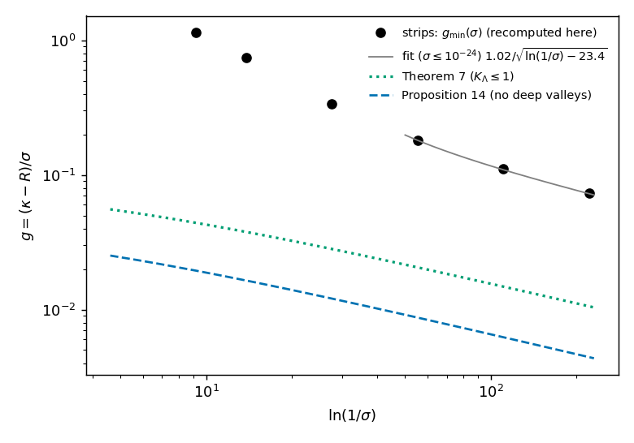

# resolution-gap-log-law

[](https://colab.research.google.com/github/neginyan/resolution-gap-log-law/blob/main/demo/resolution_gap_log_law.ipynb)
[](https://github.com/neginyan/resolution-gap-log-law/actions/workflows/verify.yml)
[](https://doi.org/10.5281/zenodo.23617343)
[](https://doi.org/10.5281/zenodo.23616985)

Code, results and verification for the paper

> T. Namba, *Is the resolution gap of the arrow of time uniform?*, preprint v1.0, Zenodo (2026), [doi:10.5281/zenodo.23617343](https://doi.org/10.5281/zenodo.23617343).

It continues four earlier papers:

- T. Namba, *Can a learned score see the margin of the arrow of time?*, preprint v1.0, Zenodo (2026), [doi:10.5281/zenodo.23408213](https://doi.org/10.5281/zenodo.23408213) (code: [learned-score-arrow-of-time](https://github.com/neginyan/learned-score-arrow-of-time)).
- T. Namba, *The resolution gap in many degrees of freedom*, preprint v1.0, Zenodo (2026), [doi:10.5281/zenodo.23371932](https://doi.org/10.5281/zenodo.23371932) (code: [resolution-gap-many-dof](https://github.com/neginyan/resolution-gap-many-dof)).
- T. Namba, *A resolution gap for the coarse-grained arrow of time in nonlinear Hamiltonian flows*, preprint v1.1, Zenodo (2026), [doi:10.5281/zenodo.23320603](https://doi.org/10.5281/zenodo.23320603) (code: [resolution-gap-arrow-of-time](https://github.com/neginyan/resolution-gap-arrow-of-time)).
- T. Namba, *Sharp criterion for the coarse-grained arrow of time in Hamiltonian dynamics*, preprint v1.2, Zenodo (2026), [doi:10.5281/zenodo.23258135](https://doi.org/10.5281/zenodo.23258135).

## Question

A Hamiltonian flow is observed through a Gaussian window of width σ that widens in time. The coarse-grained entropy grows if and only if the window widens faster than a critical rate R of the state. For Gaussian states R stays below κ, the largest symmetric strain rate of the flow, by a margin proportional to σ: the *resolution gap*. This paper asks whether **every** state has a gap of order σ, at the unstable top of the pendulum (κ = 1).

## Results

- **The uniform gap fails** (numerical). Ripple strips, states with a fine ripple along the unstable direction, reach (κ − R)/σ → 1/(2k₀) as σ → 0 for every ripple wavenumber k₀. Their smallest gap at a given σ tends to zero and follows 1.02/√(ln(1/σ) − 23.4) for σ ≤ 10⁻²⁴. Every value is confirmed by evaluations that share no code.
- **The gap is controlled by one number** (proved). An exact identity and the inequality of arithmetic and geometric means bound the gap from below (Theorem 2); a line-wise Heisenberg inequality turns this into gap ≳ 1/√x̄ for every state, where x̄ is the mean squared wavenumber of the blurred density along the unstable direction (Lemma 3, Corollary 4).
- **Fine structure is limited logarithmically** (proved under one ratio condition). A split-blur smoothing–uncertainty lemma gives the log law gap/σ ≥ c/√(ln(1/σ) + C) for states with a bounded ratio K_Λ (Lemma 6, Theorem 7).
- **The ratio condition can be removed, and the strips are covered** (proved). Following the stable-direction Fisher information as the blur grows, the only way to lose it faster is through valleys of the blurred density, and valleys are paid for in Fisher information (Lemma 11, Theorem 12). This gives the log law without any ratio condition for product states in any orientation (Theorem 13) and for every state without deep valleys (Proposition 14). The strips, which realise the smallest gaps found, form no deep valleys (numerical).
- **For general states** the log law is stated as Conjecture 1; no counterexample is known.

Every claim, with its status (proof / assumption / numerical / conjecture), is listed in [`claims.md`](claims.md); the table at its top maps the numbering of the paper to the rows.

## Check it yourself in the browser



The notebook [`demo/resolution_gap_log_law.ipynb`](demo/resolution_gap_log_law.ipynb) checks three claims of the paper from scratch in about a minute on a CPU: the smallest gap of the strips at σ = 10⁻⁴ … 10⁻⁹⁶, recomputed from the optimal parameters with an independent evaluator (downloaded from this repository, its hash checked) and compared with the fit and with the proved bounds of Theorem 7 and Proposition 14; the absence of deep valleys on the strips; and Lemma 5 on random structures. [Open it in Colab](https://colab.research.google.com/github/neginyan/resolution-gap-log-law/blob/main/demo/resolution_gap_log_law.ipynb).

## Repository layout

| path | contents |
|---|---|
| `paper/` | LaTeX source of the paper (`main.tex`, `sections/`, `figures/`) |
| `verification/run_all_E.py` | 65 checks of every claim from the stored results, with a few recomputations (about 2 minutes on one core) |
| `independent_checks/` | 12 checks written separately from the study code: the strip minima, the absence of deep valleys, Lemmas 5 and 11 |
| `demo/` | Colab notebook and its figure |
| `claims.md` | every claim with its status, the stage that produced it and the check that tests it |
| `paperE_numbers.md` | every number of the paper with its source (`file.json:key`); rebuilt by `make_numbers.py` |
| `results/` | the stored results read by the numbers and the checks |
| `code/` | the scripts that produced the results and every local module they import (list: `code/MODULES.txt`) |

## Verify

```
pip install -r requirements.txt
python make_numbers.py                      # rebuilds paperE_numbers.md from results/
python verification/run_all_E.py            # 65 checks
python independent_checks/check_paperE.py   # 12 checks
```

Every check of the verification suite states its tolerance and reports how much of it is used. Both suites run on every push with GitHub Actions (badge above). The scripts in `code/` that produced the stored results include long searches (hours on one core); they are included for transparency and are not rerun by the checks. Tested with Python 3.11, numpy 2.5.3, scipy 1.18.1, matplotlib 3.11.2.

## Use of AI assistants

This work was carried out with the help of AI assistants: Google Gemini, OpenAI ChatGPT and Anthropic Claude. The author directed the research and takes full responsibility for it. All numbers are checked by the scripts in this repository.

## License

MIT (see [`LICENSE`](LICENSE)).

## Citation

Taishi Namba, *Is the resolution gap of the arrow of time uniform?*, preprint v1.0, Zenodo (2026), [doi:10.5281/zenodo.23617343](https://doi.org/10.5281/zenodo.23617343). Code: [doi:10.5281/zenodo.23616985](https://doi.org/10.5281/zenodo.23616985) (all versions; v1.0.0 is [doi:10.5281/zenodo.23616986](https://doi.org/10.5281/zenodo.23616986)). See also [`CITATION.cff`](CITATION.cff).
